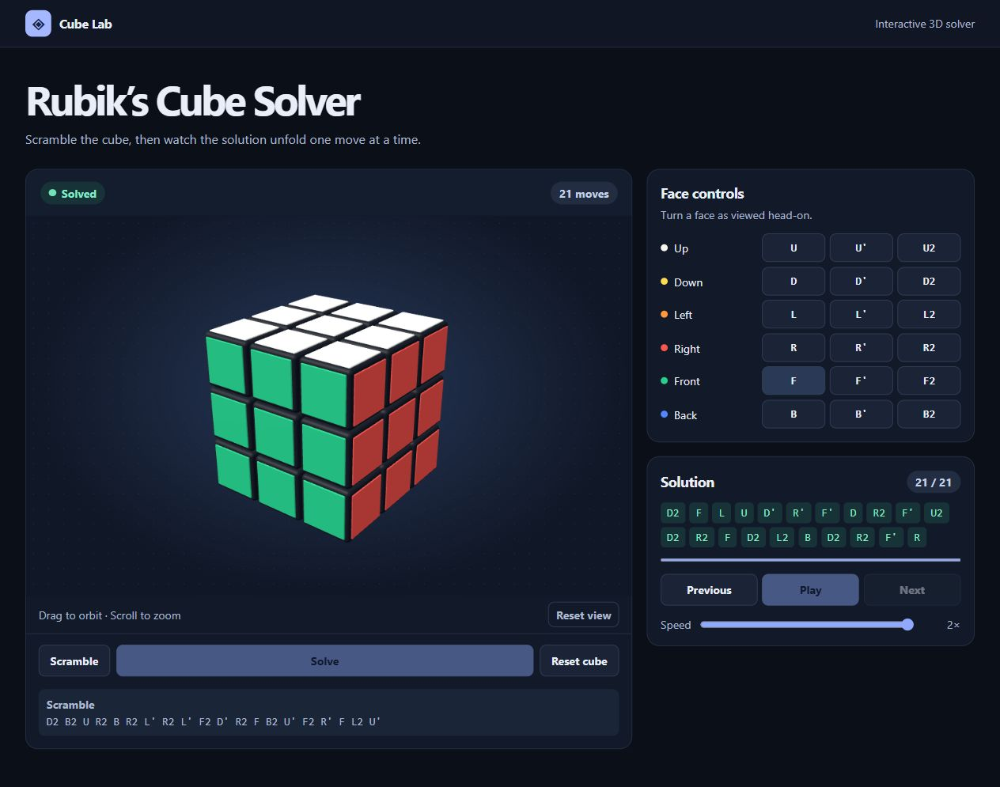
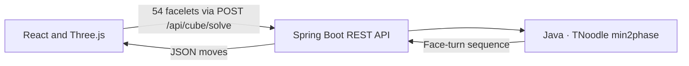

# Cube Lab

Cube Lab is a browser-based 3×3 Rubik’s Cube solver built with React, Three.js, Java, and Spring Boot. Scramble a virtual cube or turn its faces manually, then calculate a solution from the resulting sticker layout and replay it one turn at a time.

## Features

- Interactive 3D cube with 26 visible cubies, orbit, zoom, and camera reset.
- All six face rotations in clockwise, counterclockwise, and half-turn variants.
- Random 20-move scrambles, move counter, and cube reset.
- Two-phase solving from 54 facelets, with validation for physically impossible positions.
- Solution playback with Play, Pause, Previous, Next, and adjustable speed.
- Reduced-motion support and a sticker display for browsers without usable WebGL.

## Screenshot



## Architecture and stack



| Layer | Technology | Source |
| --- | --- | --- |
| UI and tooling | React, JavaScript, Vite | `frontend/src/App.jsx`, `frontend/vite.config.js` |
| Graphics and cube state | Three.js, integer-coordinate sticker permutation | `frontend/src/components/`, `frontend/src/cube.js` |
| API and validation | Java 17+, Spring Boot, Maven | `backend/src/main/java/com/rubikssolver/` |
| Solver | TNoodle min2phase, based on Kociemba’s two-phase algorithm | [Maven Central](https://central.sonatype.com/artifact/org.worldcubeassociation.tnoodle/scrambler-min2phase/0.19.2) |
| Tests | Node.js test runner, JUnit and MockMvc, live HTTP checks | `frontend/src/cube.test.js`, `backend/src/test/`, `frontend/scripts/check-api.mjs` |

The first search phase orients the cubies and places the middle-layer edges in their slice. The second phase solves the remaining permutations with a restricted move set. On the frontend, a shared pivot animates the selected layer, then the corresponding permutation commits the new sticker state.

## Quick start

Prerequisites are Java 17 or newer, Maven 3.6.3 or newer, and Node.js 22.12 or newer. The frontend and backend run in separate terminals:

```sh
cd backend
mvn spring-boot:run
```

```sh
cd frontend
npm ci
npm run dev
```

Open [localhost:5173](http://localhost:5173). The Vite development proxy forwards `/api` to Spring Boot on port 8080. The root Dockerfile also supports a single-origin install with `docker build -t cube-lab .` followed by `docker run --rm -p 8080:8080 cube-lab`.

### Environment variables

| Variable | Where | Purpose |
| --- | --- | --- |
| `VITE_API_BASE_URL` | Frontend build | Public backend origin, e.g. `https://your-backend.onrender.com`. Leave empty for same-origin serving or the local Vite proxy. |
| `DEV_API_TARGET` | Vite development server | Optional local proxy target. Defaults to `http://localhost:8080`. |
| `CUBE_ALLOWED_ORIGINS` | Backend runtime | Comma-separated list of exact allowed frontend origins, including the scheme and any port. Omit trailing slashes. Leave empty for same-origin serving. |
| `PORT` | Backend runtime | Listening port. Defaults to `8080` locally. Render supplies its service port. |

Copy [the frontend example](frontend/.env.example) to `frontend/.env.local` to override local defaults. Variables prefixed with `VITE_` are embedded in the browser bundle and are public.

## API

`POST /api/cube/solve` accepts a JSON object with 54 facelets in `URFDLB` order. Each face is read top-left to bottom-right in Kociemba orientation. Sticker letters identify their center colors.

```json
{"facelets":"UUFUUFUUFRRRRRRRRRFFDFFDFFDDDBDDBDDBLLLLLLLLLUBBUBBUBB"}
```

```json
{"moves":["R'"]}
```

The solved cube returns an empty list. Invalid or impossible states return HTTP 400, and the service returns HTTP 503 when its bounded search is busy or reaches its limit. `GET /api/cube/health` reports service availability.

## Testing

- In `frontend/`, run `npm test` and `npm run build`.
- In `backend/`, run `mvn test`.
- From the project root, run `node frontend/scripts/check-api.mjs` while Spring Boot is running. The check covers all 18 turns, 30 random scrambles, an already solved cube, and invalid inputs. Pass a backend origin or local Vite origin to test another environment.

## Deploy to Render and Vercel

1. **Render backend.** Create a Docker Web Service from the GitHub repository. Set its root directory to `backend`, Dockerfile path to `./Dockerfile` relative to that root, and HTTP health check path to `/api/cube/health`. Copy the service’s public HTTPS origin once healthy. [Render monorepo setup](https://render.com/docs/monorepo-support) · [Render health checks](https://render.com/docs/health-checks)
2. **Vercel frontend.** Import the same repository, select `frontend` as the root directory, and use the Vite preset. The repository configuration uses `npm ci`, `npm run build`, and `dist`. Set `VITE_API_BASE_URL` to the Render HTTPS origin in the intended Vercel environment. Redeploy after changing this build-time variable. [Vercel Vite setup](https://vercel.com/docs/frameworks/frontend/vite) · [Vercel environment variables](https://vercel.com/docs/environment-variables/managing-environment-variables)
3. **Allow the frontend origin.** Set `CUBE_ALLOWED_ORIGINS` in Render to the resulting Vercel origin. For preview testing, include an exact preview origin or stable preview alias. Apply the environment change and wait for the service to become healthy.
4. **Verify the live connection.** Run `node frontend/scripts/check-api.mjs https://your-backend.onrender.com`. Then open the Vercel site, select **Scramble**, **Solve**, and **Play**, and confirm the cube reaches **Solved**. In browser DevTools, confirm the preflight and POST target the Render origin, the POST returns HTTP 200, and the response permits the Vercel origin.

The solver dependency is distributed under GPL-3.0. The project currently runs without a database.

